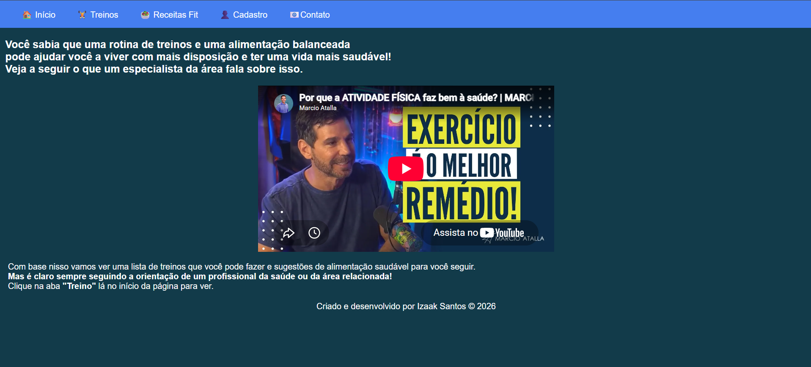
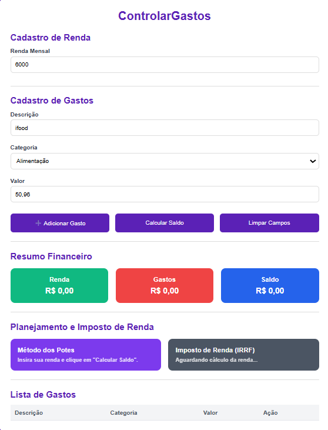
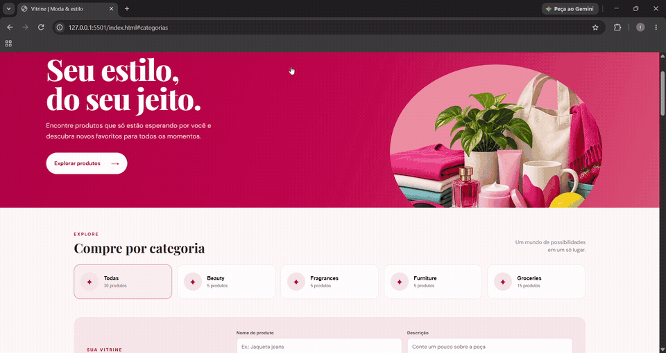

# 🤖 SYSTEM ONLINE | IZAAK SANTOS

<div align="center">


### 💻 DESENVOLVEDOR EM FORMAÇÃO | FRONT-END

**Transformando aprendizado em projetos e ideias em soluções.**

<br>

</div>

---

## 👨‍💻 Sobre mim

Olá! Eu sou **Izaak Santos**, estudante de Análise e Desenvolvimento de Sistemas e desenvolvedor em formação, com foco em desenvolvimento Front-end.

Tenho interesse em desenvolvimento web, programação e criação de soluções digitais. Busco constantemente aprimorar meus conhecimentos por meio de estudos, projetos acadêmicos e experiências práticas.

- 🎯 **Foco:** Desenvolvimento Front-end e Web.
- 💡 **Interesses:** Tecnologia, programação e inovação.
- 📚 **Estudando:** JavaScript, TypeScript e Node.js.
- 🚀 **Objetivo:** Evoluir profissionalmente e conquistar minha primeira oportunidade na área de desenvolvimento.

---

## ⚡ Stack Tecnológico

### 🎨 Front-end

<div align="left">
  
</div>

### ⚙️ Back-end

<div align="left">
  
</div>

### 🛠️ Ferramentas e ambiente de desenvolvimento

<div align="left">
  
</div>

---

## 🧠 Habilidades

| Categoria | Conhecimentos |
|:--|:--|
| **Desenvolvimento Web** | HTML5, CSS3 e JavaScript |
| **Programação** | Lógica de programação e TypeScript |
| **Back-end** | Noções básicas de Node.js |
| **Orientação a Objetos** | Fundamentos de POO |
| **Versionamento** | Git e GitHub |
| **Ferramentas** | Visual Studio Code e NPM |
| **Desenvolvimento** | Estruturação de páginas, estilização e interatividade |

---

## 🎯 Current Mission

<div align="center">


</div>

```text
╔══════════════════════════════════════════════╗
║             DEVELOPER EVOLUTION              ║
╠══════════════════════════════════════════════╣
║                                              ║
║  > Aprimorando HTML e CSS                    ║
║  > Evoluindo em JavaScript                   ║
║  > Estudando TypeScript                      ║
║  > Desenvolvendo conhecimentos em Node.js    ║
║  > Praticando POO e lógica de programação    ║
║  > Construindo projetos reais                ║
║                                              ║
║              SYSTEM: ACTIVE                  ║
╚══════════════════════════════════════════════╝
```

---

## 🚀 Projetos em Destaque

Aqui estão alguns dos projetos que desenvolvi durante minha jornada de aprendizado, colocando em prática meus conhecimentos em programação e desenvolvimento web.

### 🏋️ 01. FitLife — Saúde e Bem-estar

<div align="center">



</div>

Projeto acadêmico de desenvolvimento web voltado ao universo fitness, com páginas dedicadas a treinos, alimentação saudável e funcionalidades relacionadas à experiência do usuário.

**Principais funcionalidades:**
- Página inicial com apresentação do projeto.
- Seção de treinos e exercícios.
- Receitas e sugestões de alimentação saudável.
- Formulário de cadastro.
- Conteúdos multimídia.

**Tecnologias utilizadas:**


<div align="center">

<a href="https://github.com/IzaakCod/FitLife-avaliacao1B-CS">

</a>

</div>

---

### 💰 02. ControlaGastos — Controle Financeiro

<div align="center">



</div>

Sistema desenvolvido em equipe para auxiliar no gerenciamento das finanças pessoais, permitindo organizar receitas, despesas e acompanhar a situação financeira.

**Principais funcionalidades:**
- Cadastro de renda mensal.
- Registro e organização de gastos.
- Classificação de despesas por categorias.
- Resumo financeiro com renda, gastos e saldo.
- Planejamento financeiro pelo Método dos Potes.
- Cálculo de Imposto de Renda (IRRF).

**Tecnologias utilizadas:**


<div align="center">

<a href="https://github.com/Mia-Cardim/ControlaGastos">

</a>

</div>

---

### 🛍️ 03. Vitrine Moda & Estilo — Vitrine Virtual

<div align="center">



</div>

Projeto de desenvolvimento web que apresenta uma vitrine virtual de produtos, com navegação por categorias, cadastro de produtos e exibição de um catálogo interativo.

**Principais funcionalidades:**
- Navegação entre seções.
- Organização de produtos por categorias.
- Cadastro de produtos.
- Exibição dinâmica do catálogo.
- Apresentação de produtos com imagens e informações.

**Tecnologias utilizadas:**


<div align="center">

<a href="https://github.com/IzaakCod/Contrucao-de-sites-2">

</a>

</div>

---

## 📊 GitHub Analytics

<div align="center">


</div>

---

## 📈 Contribution Graph

<div align="center">

[](https://github.com/IzaakCod)

</div>

---

## 🐍 Contribution Snake

<div align="center">


</div>

---

## 🔗 Connect With Me

<div align="center">

<a href="https://github.com/IzaakCod">

</a>
<a href="https://www.linkedin.com/in/izaak-nascimento-78678040a">

</a>

<br><br>

### 🤖 DEVELOPER SYSTEM ONLINE

**LEARNING • BUILDING • EVOLVING**

`STATUS: ACTIVE` 🚀

</div>
